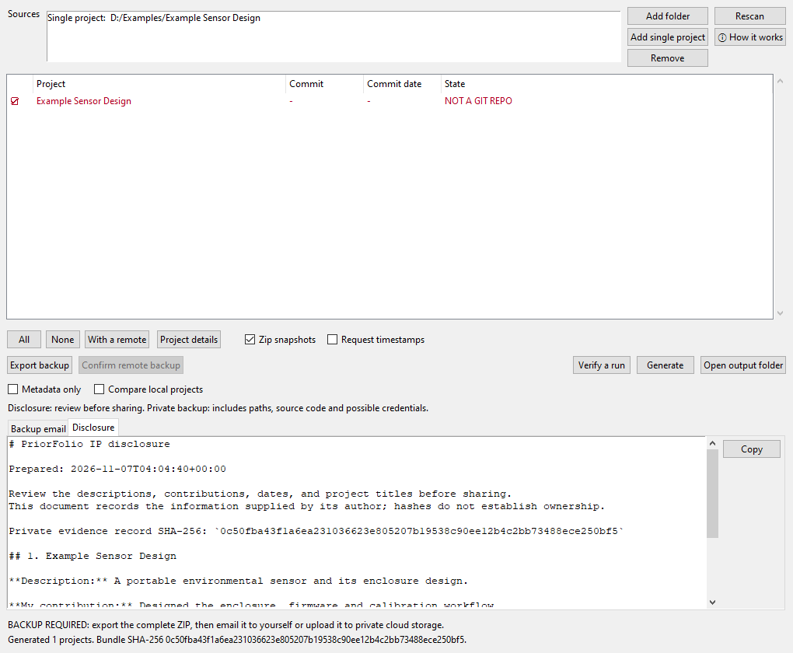

# PriorFolio

[](https://github.com/jesse-anderson/PriorFolio/actions/workflows/tests.yml)
[](https://github.com/jesse-anderson/PriorFolio/actions/workflows/tests.yml)
[](https://github.com/jesse-anderson/PriorFolio/actions/workflows/desktop.yml)
[](https://pypi.org/project/priorfolio/)
[](https://github.com/jesse-anderson/PriorFolio/blob/main/LICENSE)

Prepare IP disclosures and preserve the evidence behind them.



**Alpha release:** the local workflow is tested on Windows. Cross-platform CI is
configured; check its results before relying on another platform.

PriorFolio records local projects, lets you describe the work and your
contribution, and produces a disclosure plus private evidence. It hashes the
actual files on disk, including uncommitted edits. It never commits, stages,
fetches, or writes inside the projects being scanned.

## Run

Requires Python 3.10+ and Git. The desktop interface also requires Tkinter
(included with the standard Windows Python installer; some Linux installations
need their distribution's Tk package). Runtime code uses the Python standard
library. Windows is tested locally; CI is configured for Windows, Linux and macOS.

From a source checkout, install in a virtual environment and launch:

```console
python -m pip install .
priorfolio --gui
priorfolio --help
```

`python gui.py` also works directly from a checkout. The installed desktop
launcher is `priorfolio-gui`; `python -m priorfolio --gui` is an alternative.

Once the alpha is published to PyPI, install the pinned release with:

```console
python -m pip install "priorfolio==0.1.0a1"
priorfolio --gui
```

Git must be installed separately and available on `PATH`. Tkinter is needed
only for the desktop interface; pip cannot install the system Tk libraries.

## Desktop downloads and builds

The **Desktop builds** workflow creates Windows x64, Linux x64 and macOS arm64
archives with a windowed **PriorFolio** app and a separate **PriorFolioCLI**.
Python and Tk are bundled; Git is still installed separately. Download a release
archive, extract it completely and keep each application folder intact.
Initial builds are unsigned and macOS builds are not notarized.

To build locally on the operating system you intend to distribute for:

```console
python -m pip install -e ".[desktop]"
python scripts/build_desktop.py
```

The build checks GUI startup without opening a visible window and exercises
generation, snapshots, backup export and restoration through the frozen CLI.
Archives and SHA-256 sidecars go to `dist/desktop/`. Linux builds use Ubuntu 22.04;
macOS and Linux archives preserve the bundle's symlinks and executable permissions.
Runtime license notices are included. The Tcl/Tk fallback notices come from the
official [Tcl](https://github.com/tcltk/tcl/blob/core-8-6-13/license.terms) and
[Tk](https://github.com/tcltk/tk/blob/core-8-6-13/license.terms) 8.6 distributions.

## Disclosure workflow

1. Add a folder of projects, or **Add single project** for an individual folder.
2. Focus a project row and select **Project details**. Enter a public title,
   description, your contribution, dates or period of work, and references.
3. Tick the projects to include. Space toggles the focused row. Keep **Zip
   snapshots** enabled to preserve the actual source bytes.
4. Generate, then review the **Disclosure** tab before sharing `disclosure.zip`.
5. **Export backup** to create the complete private ZIP. Email it to yourself
   using the **Backup email** text, or save it to a private cloud-sync folder.
6. Check the received email attachment or the completed upload through the
   provider's web interface, ideally from another device. Compare the downloaded
   ZIP's SHA-256 with its `.sha256` sidecar, then **Confirm remote backup**.

Saving a local ZIP is not a completed remote backup. PriorFolio distinguishes
**backup required**, **exported**, and **confirmed by you**. It does not send
email, upload files, or independently verify delivery. An email containing only
a hash does not back up the underlying source files. If the ZIP exceeds your
mail provider's attachment limit, use private cloud storage.

The desktop app remembers the latest run and its pending backup when reopened,
and remembers earlier runs through **Previous runs**. Confirming a newer backup
does not clear reminders for older unconfirmed runs. The app checks all saved
runs before closing.

Generated document previews are read-only and match the saved exports. Edit
**Project details** and generate a new run to change a disclosure. Opening another
run switches the documents and backup actions together.

Runs default to `~/PriorFolio/runs/`. GUI sources and disclosure details are
stored privately in `~/.priorfolio/settings.json`. There is no telemetry.

## What can be shared?

| Output | Contents and intended use |
|---|---|
| `disclosure.md`, `disclosure.json`, `disclosure.zip` | Project titles, descriptions, contributions, supplied dates/references, commit identifiers, content hashes and counts. Review before sharing. |
| `evidence.json`, `evidence.md`, `manifests/` | **Private** local paths, remote identifiers, source file names, hashes and warnings. |
| `snapshots/` | **Private** ZIPs containing the exact source bytes hashed. |
| `evidence_bundle.zip` | **Private metadata only**, without snapshots. Not a complete source backup. |
| Exported backup ZIP | **Private complete evidence**, including snapshots, metadata, disclosure documents, and timestamp responses if requested. |
| `email.txt`, `BACKUP.txt` | Email-to-yourself template and backup/restore instructions. |
| `backup_status.json` | Local export receipt and your remote-copy confirmation; excluded from disclosures and exported backups. |

Disclosure exports omit automatic local paths, remote URLs, file listings,
and source contents. Anything you type into the disclosure fields is shared
as entered. The private backup is **not encrypted** and may contain credentials
from the selected projects. Use storage you control with suitable access
restrictions. PriorFolio deliberately preserves exact evidence rather than
silently removing source files.

## Command line

```console
priorfolio --root D:\projects --list
priorfolio --add D:\projects\example --select all
priorfolio --root D:\projects --select "1,4-7,example-project" --out D:\records
priorfolio --backup RUN_FOLDER --destination D:\CloudSync\PriorFolio-private.zip
priorfolio --confirm-backup RUN_FOLDER --backup-method cloud
```

Snapshots are on by default. `--no-snapshot` creates a hash-only record that
cannot provide a complete source backup. `--add` alone scans only the supplied
projects. With no roots or individual projects, the CLI scans the current folder.
Disclosure details can currently be authored through the GUI.

## Verify and restore

Unpack your own complete backup ZIP into an empty directory, then:

```console
priorfolio --verify RESTORED_FOLDER --expect RECORDED_BUNDLE_SHA256
priorfolio --verify RESTORED_FOLDER --expect RECORDED_BUNDLE_SHA256 --against-disk
priorfolio --verify UNPACKED_METADATA_BUNDLE --metadata-only --expect RECORDED_BUNDLE_SHA256
```

Full verification requires every recorded snapshot. **Metadata only** explicitly
skips snapshot checking; it never certifies a complete backup. The GUI exposes
the same option. Project paths are read only when **Compare local projects** or
`--against-disk` is enabled. Enable that only on a run you created or trust.
Comparisons report changed/missing files, not newly added files.

The bundle hash is SHA-256 of `evidence.json`; keep it separately, such as in
your email. A folder containing its own hashes only proves self-consistency.
An independently retained expected hash ties verification to your earlier record.
The backup ZIP's sidecar hash is a separate checksum of the entire exported ZIP.

The content hash is SHA-256 of a UTF-8 manifest, sorted by relative path, with
one SHA-256 per file. Manifests follow `sha256sum -c` escaping conventions.
Line-ending conversions or Unicode filename normalization can change the bytes
on a new checkout. Keep the snapshots to reproduce the recorded state exactly.

## Timestamp responses

Timestamp requests are **off by default**. `--timestamp` or **Request timestamps**
sends the evidence JSON's SHA-256 and a random nonce to DigiCert, Sectigo and
FreeTSA. No project names or source bytes are sent. The services receive the
request's network metadata, including the originating IP address.

PriorFolio stores the responses and checks basic status/digest consistency.
It does **not** validate timestamp signatures or certificate trust. Reported
times are unverified labels, and a successful hash check is not proof of an
authentic timestamp. Two configured endpoints use HTTP; responses must not be
trusted without independent signature verification.

For external verification with an independently trusted TSA certificate bundle:

```console
openssl ts -reply -in timestamps/digicert.tsr -text
openssl ts -verify -data evidence.json -in timestamps/digicert.tsr -CAfile trusted-tsa-ca-bundle.pem
```

## Scope and limits

- Hashes identify bytes; they do not establish authorship, ownership or a date.
  Git commit dates and user-entered dates are recorded claims.
- Git-tracked files and untracked, non-ignored files are included. Dependency
  folders, caches and virtual environments are skipped when untracked.
- Symlinks, junctions, nested repositories and submodules are not followed.
  Add nested repositories separately. Every intentional exclusion is noted.
- Read failures produce warnings. Review them; a verified incomplete record
  remains incomplete. This is a sequential snapshot, not an atomic filesystem freeze.
- PriorFolio is not legal advice. Review disclosure wording for your situation.

## Development and license

```console
python -m pip install -e ".[dev]"
python -m pytest
python -m pytest --cov --cov-report=term-missing --cov-report=json:coverage.json
python -m build
python -m twine check --strict dist/*
python scripts/check_dist.py dist
```

Tests create synthetic projects in temporary directories. GUI tests exercise
real Tk windows and skip when a display is unavailable. Set
`PRIORFOLIO_TEST_OFFSCREEN=1` to keep test windows outside the visible desktop;
this still requires a working display. `PRIORFOLIO_NETWORK=1`
enables live timestamp-service tests; `PRIORFOLIO_SLOW=1` enables a 2.2 GB fixture.
The coverage badge reports measured line coverage of the CLI, export logic and
GUI, including subprocess execution. CI also records branch coverage. Build and
launcher scripts are outside that application metric. The badge updates after
the full test matrix passes on `main`; PyPI's version badge resolves after the
first package upload.
See [Contributing](https://github.com/jesse-anderson/PriorFolio/blob/main/CONTRIBUTING.md),
[Security](https://github.com/jesse-anderson/PriorFolio/blob/main/SECURITY.md), and
[Releasing](https://github.com/jesse-anderson/PriorFolio/blob/main/RELEASING.md).

Copyright (c) 2026 Jesse Anderson. Licensed under the **GNU General Public
License, version 3 only (GPL-3.0-only)**; see
[LICENSE](https://github.com/jesse-anderson/PriorFolio/blob/main/LICENSE). Provided without
warranty. The application license does not change the license of your inputs.
